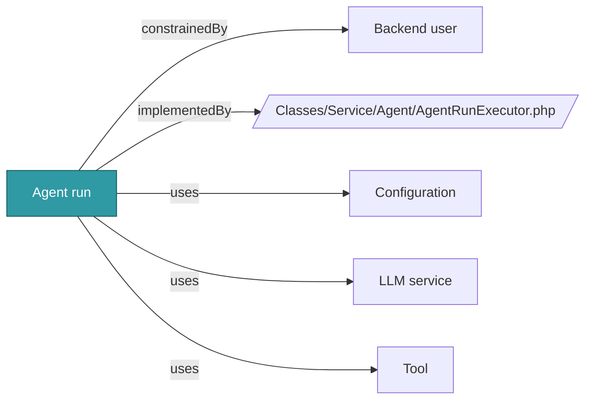

# Definition

An agent run is one execution of a tool-using agent. It runs under one configuration and on behalf of one backend user. It loops in rounds: each round asks the model, and the model can call tools. The run records its status, its token use, its cost and its outcome.

# Not to be confused with

- A task. A task is one prompt, an agent run is a loop with tools.
- An AI session: a stored conversation (`tx_nrllm_ai_session`). That is not modelled here.

# Neighbours

Generated from the relation tables by `check-ontology.py --write-diagrams`. A solid arrow is an asserted relation, a dotted arrow a hypothesis; a slanted box is a file of the repository.

# Relations

| Relation | Target | Evidence file | Evidence text | Status |
|---|---|---|---|---|
| `uses` | [Configuration](configuration.md) | `Classes/Service/Agent/AgentRunRequest.php` | `public LlmConfiguration $configuration,` | asserted |
| `constrainedBy` | [Backend user](backend-user.md) | `Classes/Service/Agent/AgentRunExecutor.php` | `private ?ActingBackendUserResolverInterface $actingBackendUserResolver = null` | asserted |
| `uses` | [LLM service](llm-service.md) | `Classes/Service/Tool/ToolLoopService.php` | `Each round calls {@see LlmServiceManagerInterface::chatWithToolsForConfiguration()}` | asserted |
| `uses` | [Tool](tool.md) | `Classes/Service/Agent/AgentRunExecutor.php` | `private ToolLoopServiceInterface $toolLoop` | asserted |
| `implementedBy` | `Classes/Service/Agent/AgentRunExecutor.php` | `Classes/Service/Agent/AgentRunExecutor.php` | `class AgentRunExecutor` | asserted |

# Notes

- The run stores both the configuration record ID and its identifier.
- Which tools a run may call is set by its configuration (tool groups, excluded tools) and by the permissions of its backend user.
