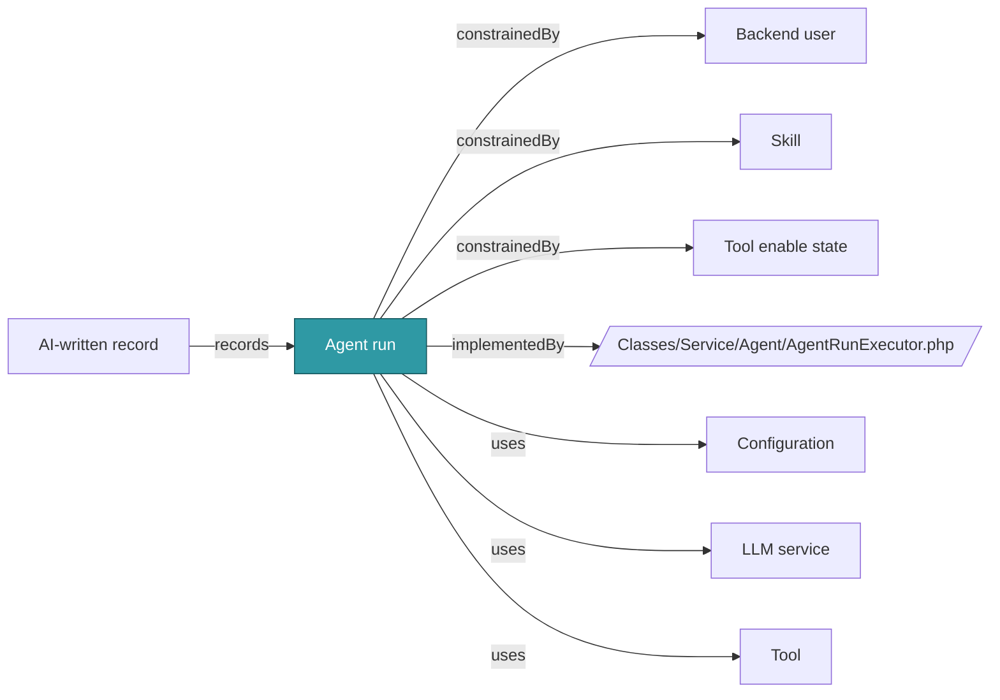

# Definition

An agent run is one execution of a tool-using agent. It runs under one configuration and on behalf of one backend user. It loops in rounds: each round asks the model, and the model can call tools. The run records its status, its token use, its cost and its outcome.

# Not to be confused with

- A task. A task is one prompt, an agent run is a loop with tools.
- An AI session: a stored conversation (`tx_nrllm_ai_session`). That is not modelled here.

# Neighbours

Generated from the relation tables by `check-ontology.py --write-diagrams`. A solid arrow is an asserted relation, a dotted arrow a hypothesis; a slanted box is a file of the repository.

# Relations

| Relation | Target | Evidence file | Evidence text | Status |
|---|---|---|---|---|
| `uses` | [Configuration](configuration.md) | `Classes/Service/Agent/AgentRunRequest.php` | `public LlmConfiguration $configuration,` | asserted |
| `constrainedBy` | [Backend user](backend-user.md) | `Classes/Service/Agent/AgentRunExecutor.php` | `private ?ActingBackendUserResolverInterface $actingBackendUserResolver = null` | asserted |
| `uses` | [LLM service](llm-service.md) | `Classes/Service/Tool/ToolLoopService.php` | `$resp = $this->mgr->chatWithToolsForConfiguration(` | asserted |
| `uses` | [Tool](tool.md) | `Classes/Service/Agent/AgentRunExecutor.php` | `private ToolLoopServiceInterface $toolLoop` | asserted |
| `constrainedBy` | [Tool enable state](tool-enable-state.md) | `Classes/Service/Tool/ToolCallPolicy.php` | `private ToolAvailabilityServiceInterface $availability,` | asserted |
| `constrainedBy` | [Skill](skill.md) | `Classes/Service/Tool/ToolCallPolicy.php` | `return $this->allowedTools->resolveForRun($configuration, $forcedSkills);` | asserted |
| `implementedBy` | `Classes/Service/Agent/AgentRunExecutor.php` | `Classes/Service/Agent/AgentRunExecutor.php` | `class AgentRunExecutor` | asserted |

# Notes

- The run stores both the configuration record ID and its identifier.
- Which tools a run may call is decided by the tool call policy (`Classes/Service/Tool/ToolCallPolicy.php`), which the tool loop asks for every call. Its gates, in order: the tool is registered; the tool enable state has the tool and its group switched on; a tool that requires an administrator runs only for an admin backend user; the skill allow-list of the run, with the tool groups the configuration allows applied on top; the tools the configuration excludes, now and at the start of the run; the trust zone of the configuration. The backend user enters only through the admin check.
- The skill allow-list is the union of the `allowed-tools` lists of the skills the run carries (the skills of its task, its configuration and the run's forced skills), resolved once at the start of the run. A skill without the key adds no restriction, unless it is orphaned, disabled by a sync or, when invoked, not admitted: then the run gets an empty allow-list and may call no tool. When no attached skill declares a list and none of these cases applies, every tool passes this gate. A skill that declares an empty list blocks every tool; only a run that is not bound to a process may still call the skill load tool (`Classes/Service/Tool/AllowedToolsResolver.php`, `Classes/Service/Tool/ToolCallPolicy.php`).
- A skill that a configuration or a task still has attached cannot be deleted, because its deletion would lift such a restriction (`Classes/Hook/SkillDeletionGuardHook.php`).
