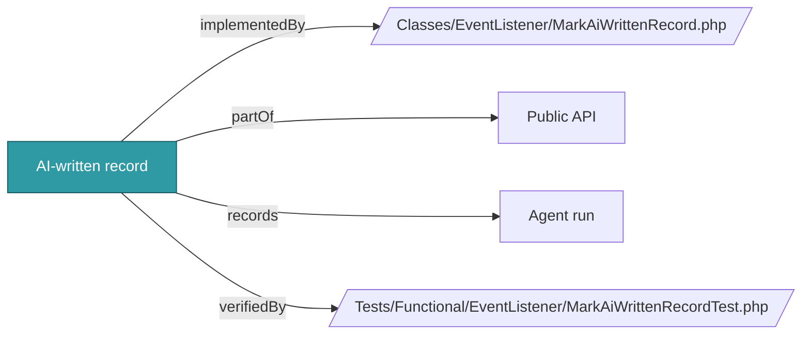

# Definition

An AI-written record is a row of `pages` or `tt_content` that an agent run created or changed. Each successful write of a run dispatches an event that names the run, the record, the kind of write and the workspace. The shipped listener sets the field `tx_nrllm_ai_written` on the row, in a draft workspace on the version the write changed there. Other listeners can add a label, an audit entry or a report; nr-llm ships none of those.

# Not to be confused with

- The trace of the agent run (`tx_nrllm_agentrun`), which holds the steps of the run.

# Neighbours

Generated from the relation tables by `check-ontology.py --write-diagrams`. A solid arrow is an asserted relation, a dotted arrow a hypothesis; a slanted box is a file of the repository.

# Relations

| Relation | Target | Evidence file | Evidence text | Status |
|---|---|---|---|---|
| `records` | [Agent run](agent-run.md) | `Classes/Service/Tool/ToolLoopService.php` | `$event = new AfterAiRecordWrittenEvent(` | asserted |
| `partOf` | [Public API](public-api.md) | `Tests/Unit/Api/api-surface.txt` | `Netresearch\NrLlm\Event\AfterAiRecordWrittenEvent (class)` | asserted |
| `implementedBy` | `Classes/EventListener/MarkAiWrittenRecord.php` | `Classes/EventListener/MarkAiWrittenRecord.php` | `public const FIELD = 'tx_nrllm_ai_written';` | asserted |
| `verifiedBy` | `Tests/Functional/EventListener/MarkAiWrittenRecordTest.php` | `Tests/Functional/EventListener/MarkAiWrittenRecordTest.php` | `class MarkAiWrittenRecordTest` | asserted |

# Notes

- The writer of a field fill run dispatches the same event (`Classes/Service/Agent/FieldFill/FieldFillWriter.php`).
- The listener marks created and updated rows only; a delete, a move, a publish or a copy leaves the field as it is.
