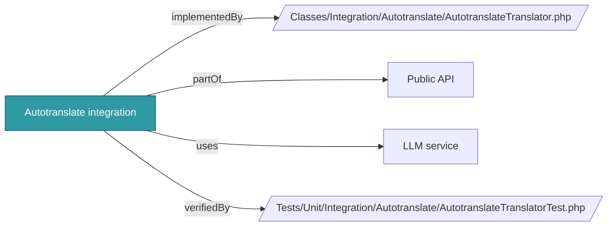

# Definition

The autotranslate integration is a translator class for the extension EXT:autotranslate. autotranslate uses it when its setting `translatorClass` names it. The class extends the DeepL translator class that autotranslate expects, but never reaches DeepL: it passes the texts to the translation service of nr-llm, which uses the translator named in `autotranslate.translator` or, when that is empty, the language model.

# Neighbours

Generated from the relation tables by `check-ontology.py --write-diagrams`. A solid arrow is an asserted relation, a dotted arrow a hypothesis; a slanted box is a file of the repository.

# Relations

| Relation | Target | Evidence file | Evidence text | Status |
|---|---|---|---|---|
| `uses` | [LLM service](llm-service.md) | `Classes/Integration/Autotranslate/AutotranslateTranslator.php` | `private readonly TranslationServiceInterface $translationService,` | asserted |
| `partOf` | [Public API](public-api.md) | `Tests/Unit/Api/api-surface.txt` | `Netresearch\NrLlm\Integration\Autotranslate\AutotranslateTranslator (class)` | asserted |
| `implementedBy` | `Classes/Integration/Autotranslate/AutotranslateTranslator.php` | `Classes/Integration/Autotranslate/AutotranslateTranslator.php` | `final class AutotranslateTranslator extends Translator` | asserted |
| `verifiedBy` | `Tests/Unit/Integration/Autotranslate/AutotranslateTranslatorTest.php` | `Tests/Unit/Integration/Autotranslate/AutotranslateTranslatorTest.php` | `class AutotranslateTranslatorTest` | asserted |

# Notes

- The class name is part of the public API because it is a configuration value of autotranslate.
