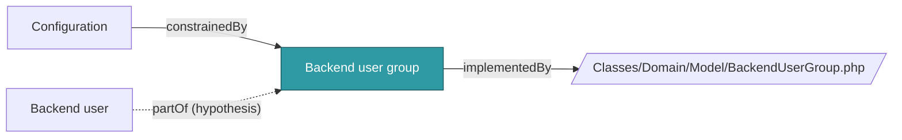

# Definition

A backend user group is a group of the TYPO3 backend (table `be_groups` of TYPO3). A configuration names the groups whose members may use it.

# Neighbours

Generated from the relation tables by `check-ontology.py --write-diagrams`. A solid arrow is an asserted relation, a dotted arrow a hypothesis; a slanted box is a file of the repository.

# Relations

| Relation | Target | Evidence file | Evidence text | Status |
|---|---|---|---|---|
| `implementedBy` | `Classes/Domain/Model/BackendUserGroup.php` | `Classes/Domain/Model/BackendUserGroup.php` | `class BackendUserGroup` | asserted |
