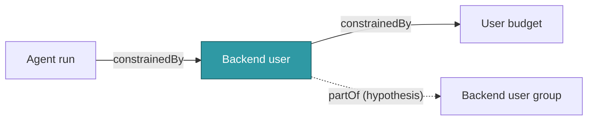

# Definition

A backend user is an account of the TYPO3 backend (table `be_users` of TYPO3). nr-llm sets a user budget per backend user, and an agent run acts on behalf of one backend user.

# Neighbours

Generated from the relation tables by `check-ontology.py --write-diagrams`. A solid arrow is an asserted relation, a dotted arrow a hypothesis; a slanted box is a file of the repository.

# Relations

| Relation | Target | Evidence file | Evidence text | Status |
|---|---|---|---|---|
| `constrainedBy` | [User budget](user-budget.md) | `Configuration/TCA/tx_nrllm_user_budget.php` | `'foreign_table' => 'be_users'` | asserted |
| `partOf` | [Backend user group](backend-user-group.md) |  |  | hypothesis |

# Notes

- The `partOf` row is a hypothesis: the group membership is a TYPO3 core relation, and this bundle names no evidence in nr-llm for it.
