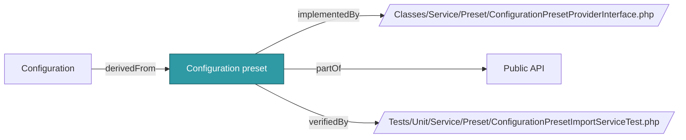

# Definition

A configuration preset is a configuration that a consuming extension declares it needs. It names an identifier and model requirements as selection criteria, never a concrete provider, model or API key. A preset provider is an extension point: a third party implements the preset provider interface, which carries the tag `nr_llm.configuration_preset`. nr-llm lists a declared preset that is not yet imported as pending, and an administrator imports it. The import creates a configuration in the mode `criteria` and stores the checksum of the preset, so that a later change of the declaration shows as drift and can be applied after a review.

# Not to be confused with

- The configuration that the import creates. The preset is the declaration, the configuration is the record.

# Neighbours

Generated from the relation tables by `check-ontology.py --write-diagrams`. A solid arrow is an asserted relation, a dotted arrow a hypothesis; a slanted box is a file of the repository.

# Relations

| Relation | Target | Evidence file | Evidence text | Status |
|---|---|---|---|---|
| `partOf` | [Public API](public-api.md) | `Tests/Unit/Api/api-surface.txt` | `Netresearch\NrLlm\Service\Preset\ConfigurationPresetProviderInterface (interface)` | asserted |
| `implementedBy` | `Classes/Service/Preset/ConfigurationPresetProviderInterface.php` | `Classes/Service/Preset/ConfigurationPresetProviderInterface.php` | `interface ConfigurationPresetProviderInterface` | asserted |
| `verifiedBy` | `Tests/Unit/Service/Preset/ConfigurationPresetImportServiceTest.php` | `Tests/Unit/Service/Preset/ConfigurationPresetImportServiceTest.php` | `class ConfigurationPresetImportServiceTest` | asserted |

# Notes

- An update from a changed preset never touches the fields the administrator owns: active state, default flag, backend groups and fallback chain (`Classes/Service/Preset/ConfigurationPresetImportService.php`).
