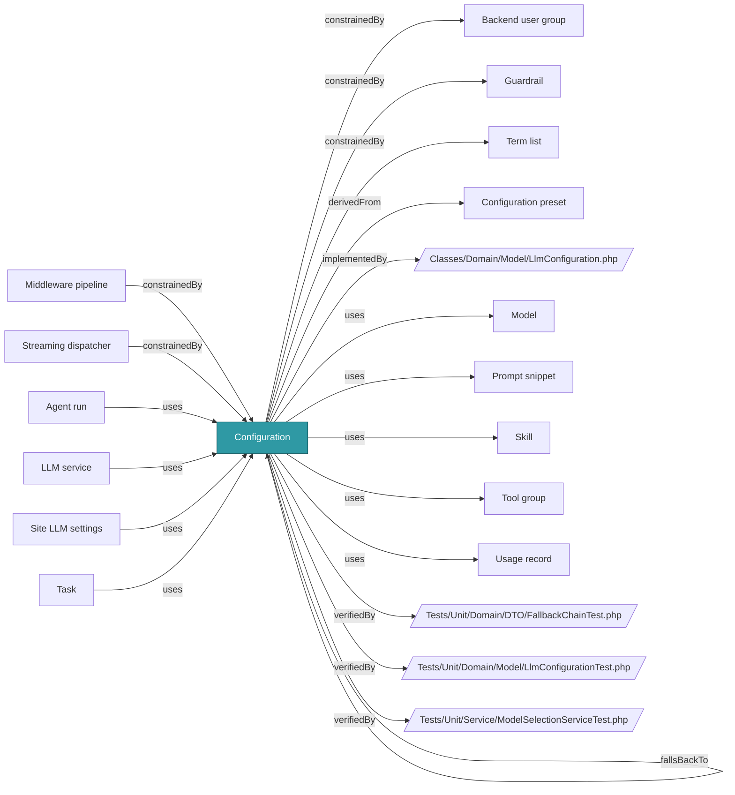

# Definition

A configuration is a named bundle for one use case. It names a model, or criteria by which a model is chosen at request time. It holds the system prompt, the model parameters, daily limits, the backend groups that may use it, and the skills, tool groups and guardrails an agent run under it may use. A configuration is the third tier of the three-tier configuration, and the unit that consuming code asks for by identifier.

# Not to be confused with

- The extension configuration of TYPO3 (`ext_conf_template.txt`). That configures nr-llm as a whole.
- A [configuration preset](configuration-preset.md): a consuming extension declares the configurations it needs as presets, and an administrator imports one. A preset states requirements (model capabilities and constraints), never a concrete provider or model; the imported configuration runs in the mode `criteria`.

# Neighbours

Generated from the relation tables by `check-ontology.py --write-diagrams`. A solid arrow is an asserted relation, a dotted arrow a hypothesis; a slanted box is a file of the repository.

# Relations

| Relation | Target | Evidence file | Evidence text | Status |
|---|---|---|---|---|
| `uses` | [Model](model.md) | `Configuration/TCA/tx_nrllm_configuration.php` | `'model_uid' =>` | asserted |
| `uses` | [Model](model.md) | `Configuration/TCA/tx_nrllm_configuration.php` | `'model_selection_criteria' =>` | asserted |
| `fallsBackTo` | [Configuration](configuration.md) | `Classes/Domain/DTO/FallbackChain.php` | `Ordered list of LlmConfiguration identifiers to try when the primary` | asserted |
| `constrainedBy` | [Guardrail](guardrail.md) | `Configuration/TCA/tx_nrllm_configuration.php` | `'allowed_guardrails' =>` | asserted |
| `constrainedBy` | [Term list](term-list.md) | `Configuration/TCA/tx_nrllm_term_list.php` | `'foreign_table' => 'tx_nrllm_configuration'` | asserted |
| `constrainedBy` | [Configuration](configuration.md) | `Configuration/TCA/tx_nrllm_configuration.php` | `'rule_judge_configuration' =>` | asserted |
| `constrainedBy` | [Backend user group](backend-user-group.md) | `ext_tables.sql` | `CREATE TABLE tx_nrllm_configuration_begroups_mm` | asserted |
| `uses` | [Skill](skill.md) | `ext_tables.sql` | `CREATE TABLE tx_nrllm_configuration_skill_mm` | asserted |
| `uses` | [Tool group](tool-group.md) | `Configuration/TCA/tx_nrllm_configuration.php` | `'allowed_tool_groups' =>` | asserted |
| `uses` | [Prompt snippet](prompt-snippet.md) | `Configuration/TCA/tx_nrllm_configuration.php` | `'snippet_tags' =>` | asserted |
| `derivedFrom` | [Configuration preset](configuration-preset.md) | `ext_tables.sql` | `preset_checksum varchar(64) DEFAULT '' NOT NULL,` | asserted |
| `uses` | [Usage record](usage-record.md) | `Classes/Service/BudgetService.php` | `$this->usageWindows->aggregateForConfiguration(` | asserted |
| `implementedBy` | `Classes/Domain/Model/LlmConfiguration.php` | `Classes/Domain/Model/LlmConfiguration.php` | `class LlmConfiguration extends AbstractEntity` | asserted |
| `verifiedBy` | `Tests/Unit/Domain/Model/LlmConfigurationTest.php` | `Tests/Unit/Domain/Model/LlmConfigurationTest.php` | `class LlmConfigurationTest` | asserted |
| `verifiedBy` | `Tests/Unit/Domain/DTO/FallbackChainTest.php` | `Tests/Unit/Domain/DTO/FallbackChainTest.php` | `class FallbackChainTest` | asserted |
| `verifiedBy` | `Tests/Unit/Service/ModelSelectionServiceTest.php` | `Tests/Unit/Service/ModelSelectionServiceTest.php` | `class ModelSelectionServiceTest` | asserted |

# Notes

- The two `uses` rows to Model are two modes. In the mode `fixed`, the configuration names one model in `model_uid`. In the mode `criteria`, the model selection service picks a model at request time, so every model that meets the criteria is a candidate. A change to a model therefore affects a criteria configuration only if that model is or becomes a candidate.
- The `constrainedBy` row to Configuration is the rule judge: a second configuration that judges the output of this one.
- The fallback chain stores configuration identifiers, not record IDs. A renamed identifier breaks the chain.
- The `derivedFrom` row holds for configurations imported from a preset only; their `preset_checksum` is not empty.
- The `uses` row to Usage record is the daily limit check: it sums the usage records of the configuration for the current day, across all users.
- A call that names no configuration and pins no provider gets the configuration its site names in the [site LLM settings](site-llm-settings.md), else the installation default, the active configuration with `is_default` set. The default is skipped when it has no model or is restricted to backend groups; the call then needs a pinned provider (`Classes/Service/ConfigurationResolver.php`).
- The budget middleware checks the daily limits of the primary configuration only; a configuration the fallback chain switches to is not checked again (comment in `Classes/Provider/Middleware/BudgetMiddleware.php`).
