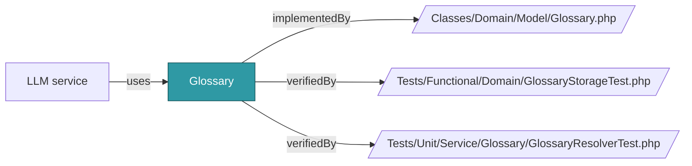

# Definition

A glossary holds the term pairs that one site uses when it translates from one language into another. The translation service reads the glossary of the site and the language pair of a translation. ADR-208 records the decision.

# Not to be confused with

- This ontology. The ontology defines the concepts of nr-llm; a glossary is content of one site.
- A term list.

# Neighbours

Generated from the relation tables by `check-ontology.py --write-diagrams`. A solid arrow is an asserted relation, a dotted arrow a hypothesis; a slanted box is a file of the repository.

# Relations

| Relation | Target | Evidence file | Evidence text | Status |
|---|---|---|---|---|
| `implementedBy` | `Classes/Domain/Model/Glossary.php` | `Classes/Domain/Model/Glossary.php` | `class Glossary extends AbstractEntity` | asserted |
| `verifiedBy` | `Tests/Functional/Domain/GlossaryStorageTest.php` | `Tests/Functional/Domain/GlossaryStorageTest.php` | `class GlossaryStorageTest` | asserted |
| `verifiedBy` | `Tests/Unit/Service/Glossary/GlossaryResolverTest.php` | `Tests/Unit/Service/Glossary/GlossaryResolverTest.php` | `final class GlossaryResolverTest extends TestCase` | asserted |
