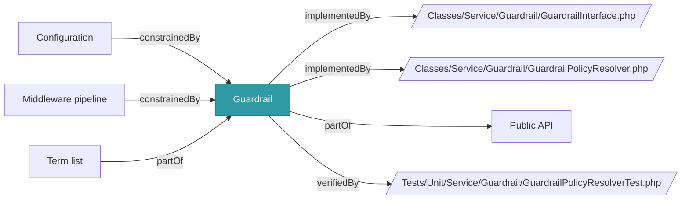

# Definition

A guardrail is a check on the input or the output of a call. It can redact secrets, add a hint, or block the answer. A configuration names the guardrails it allows; a policy resolver decides which ones apply to a call.

# Neighbours

Generated from the relation tables by `check-ontology.py --write-diagrams`. A solid arrow is an asserted relation, a dotted arrow a hypothesis; a slanted box is a file of the repository.

# Relations

| Relation | Target | Evidence file | Evidence text | Status |
|---|---|---|---|---|
| `implementedBy` | `Classes/Service/Guardrail/GuardrailInterface.php` | `Classes/Service/Guardrail/GuardrailInterface.php` | `interface GuardrailInterface` | asserted |
| `implementedBy` | `Classes/Service/Guardrail/GuardrailPolicyResolver.php` | `Classes/Service/Guardrail/GuardrailPolicyResolver.php` | `class GuardrailPolicyResolver` | asserted |
| `partOf` | [Public API](public-api.md) | `Classes/Service/Guardrail/GuardrailInterface.php` | `@api Extension point` | asserted |
| `verifiedBy` | `Tests/Unit/Service/Guardrail/GuardrailPolicyResolverTest.php` | `Tests/Unit/Service/Guardrail/GuardrailPolicyResolverTest.php` | `final class GuardrailPolicyResolverTest extends TestCase` | asserted |
