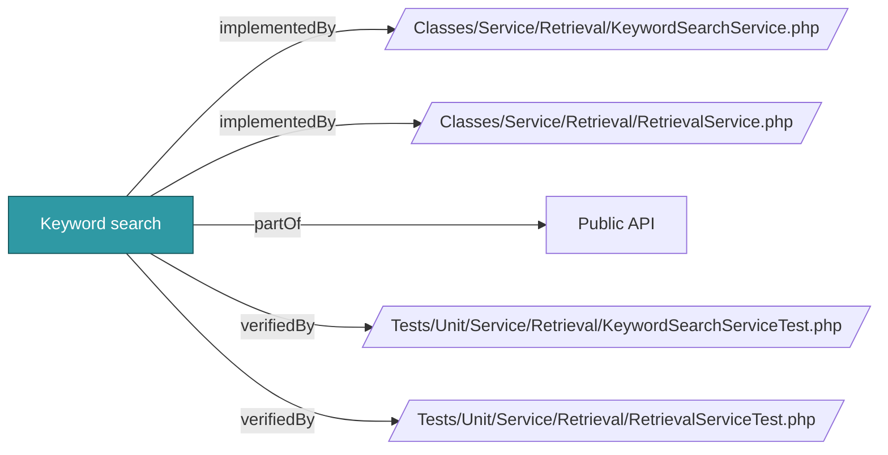

# Definition

Keyword search is the public facade for a keyword search over the site. It asks the registered search backends in the order of their priority, and the first available backend answers; results are never merged across backends. The hits are filtered to what an anonymous visitor may read. The facade never throws: a failure yields an empty list. A search backend is an extension point: a third party adds one by implementing the search backend interface, which carries the tag `nr_llm.retrieval_backend`.

# Not to be confused with

- The reranker, which scores candidates a consumer already has.

# Neighbours

Generated from the relation tables by `check-ontology.py --write-diagrams`. A solid arrow is an asserted relation, a dotted arrow a hypothesis; a slanted box is a file of the repository.

# Relations

| Relation | Target | Evidence file | Evidence text | Status |
|---|---|---|---|---|
| `partOf` | [Public API](public-api.md) | `Tests/Unit/Api/api-surface.txt` | `Netresearch\NrLlm\Service\Retrieval\KeywordSearchInterface (interface)` | asserted |
| `partOf` | [Public API](public-api.md) | `Tests/Unit/Api/api-surface.txt` | `Netresearch\NrLlm\Service\Retrieval\SearchBackendInterface (interface)` | asserted |
| `implementedBy` | `Classes/Service/Retrieval/KeywordSearchService.php` | `Classes/Service/Retrieval/KeywordSearchService.php` | `final class KeywordSearchService implements KeywordSearchInterface` | asserted |
| `implementedBy` | `Classes/Service/Retrieval/RetrievalService.php` | `Classes/Service/Retrieval/KeywordSearchService.php` | `new RetrievalService($this->selectedBackends())` | asserted |
| `verifiedBy` | `Tests/Unit/Service/Retrieval/KeywordSearchServiceTest.php` | `Tests/Unit/Service/Retrieval/KeywordSearchServiceTest.php` | `class KeywordSearchServiceTest` | asserted |
| `verifiedBy` | `Tests/Unit/Service/Retrieval/RetrievalServiceTest.php` | `Tests/Unit/Service/Retrieval/RetrievalServiceTest.php` | `class RetrievalServiceTest` | asserted |

# Notes

- The two `partOf` rows are two parts of the public API: the facade that consumers call and the backend interface that third parties implement (`Documentation/Api/Stability.rst`).
- The container has a second variant without the database LIKE fallback, under the service name `nr_llm.keyword_search.index_backed`.
