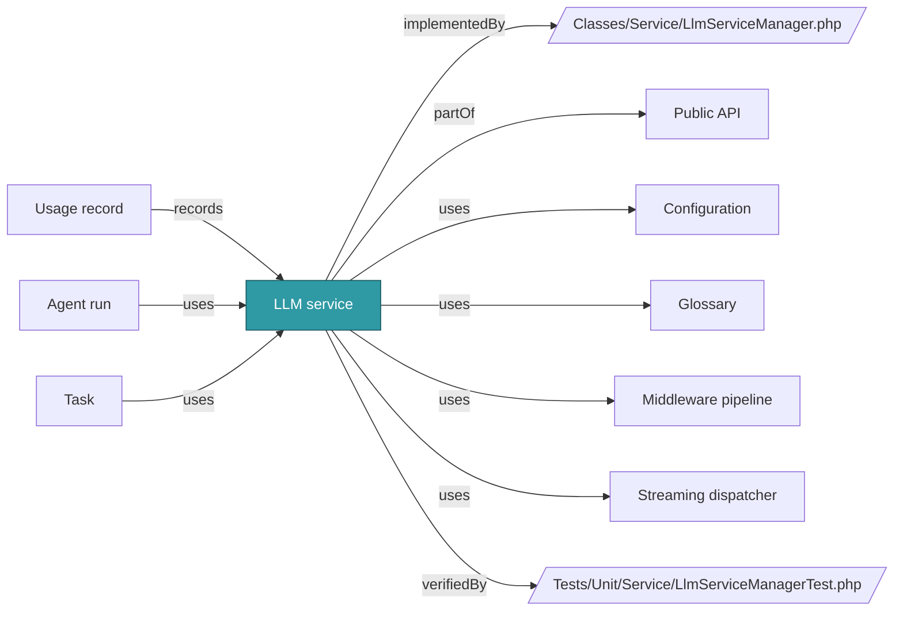

# Definition

The LLM service is the surface that consuming code calls. Its entry point is the LLM service manager. Behind it, one feature service exists for each kind of call: completion, conversation, embedding, tool calling, translation and vision. A call that returns its answer at once runs through the middleware pipeline; a streamed call runs through the streaming dispatcher instead.

# Neighbours

Generated from the relation tables by `check-ontology.py --write-diagrams`. A solid arrow is an asserted relation, a dotted arrow a hypothesis; a slanted box is a file of the repository.

# Relations

| Relation | Target | Evidence file | Evidence text | Status |
|---|---|---|---|---|
| `uses` | [Middleware pipeline](middleware-pipeline.md) | `Classes/Service/LlmServiceManager.php` | `private MiddlewarePipeline $pipeline` | asserted |
| `uses` | [Streaming dispatcher](streaming-dispatcher.md) | `Classes/Service/LlmServiceManager.php` | `private ?StreamingDispatcher $streaming = null` | asserted |
| `uses` | [Configuration](configuration.md) | `Classes/Service/LlmServiceManager.php` | `public function chatWithConfiguration(` | asserted |
| `uses` | [Glossary](glossary.md) | `Classes/Service/Feature/TranslationService.php` | `GlossaryResolverInterface $glossaryResolver` | asserted |
| `partOf` | [Public API](public-api.md) | `Documentation/Api/Stability.rst` | `Classes and interfaces you *call*: the feature services` | asserted |
| `implementedBy` | `Classes/Service/LlmServiceManager.php` | `Classes/Service/LlmServiceManager.php` | `class LlmServiceManager` | asserted |
| `verifiedBy` | `Tests/Unit/Service/LlmServiceManagerTest.php` | `Tests/Unit/Service/LlmServiceManagerTest.php` | `class LlmServiceManagerTest` | asserted |

# Notes

- The glossary row holds for translation calls only.
