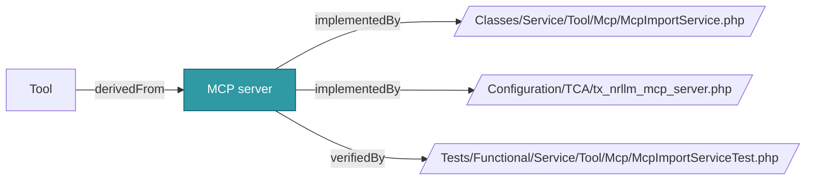

# Definition

An MCP server is a remote server that speaks the Model Context Protocol (MCP). An administrator registers its URL and authentication. nr-llm imports the tools the server offers, and an agent run can then call them.

# Neighbours

Generated from the relation tables by `check-ontology.py --write-diagrams`. A solid arrow is an asserted relation, a dotted arrow a hypothesis; a slanted box is a file of the repository.

# Relations

| Relation | Target | Evidence file | Evidence text | Status |
|---|---|---|---|---|
| `implementedBy` | `Classes/Service/Tool/Mcp/McpImportService.php` | `Classes/Service/Tool/Mcp/McpImportService.php` | `class McpImportService` | asserted |
| `implementedBy` | `Configuration/TCA/tx_nrllm_mcp_server.php` | `Configuration/TCA/tx_nrllm_mcp_server.php` | `'requires_approval' =>` | asserted |
| `verifiedBy` | `Tests/Functional/Service/Tool/Mcp/McpImportServiceTest.php` | `Tests/Functional/Service/Tool/Mcp/McpImportServiceTest.php` | `final class McpImportServiceTest extends AbstractFunctionalTestCase` | asserted |
