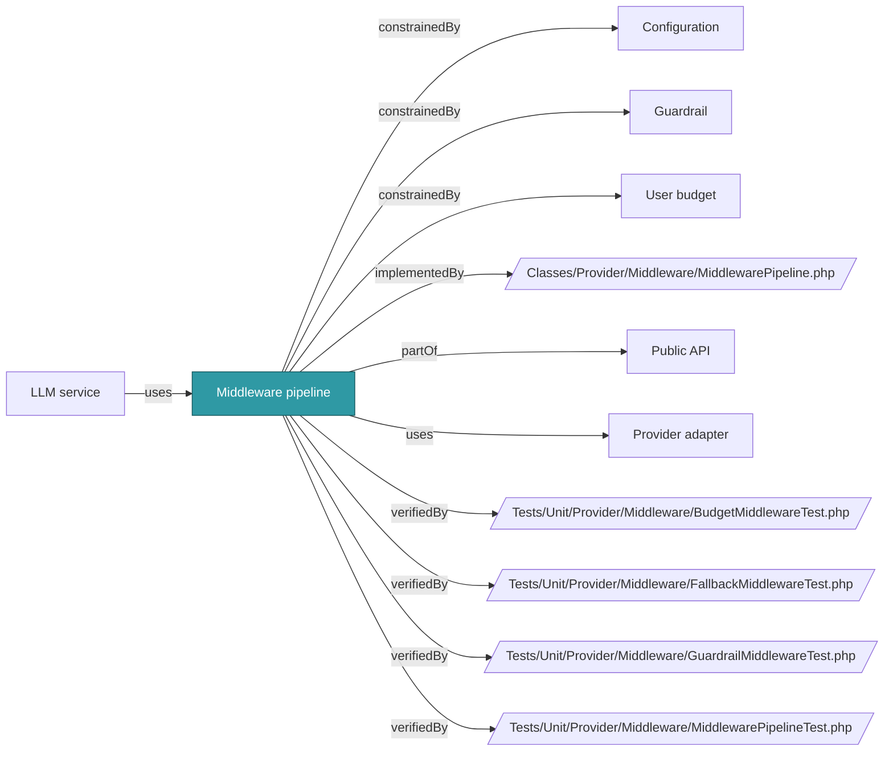

# Definition

The middleware pipeline is the chain of steps that a non-streamed call through the LLM service passes on its way to a provider adapter. `Classes/Provider/Middleware/` holds one class per step: budget, cache, circuit breaker, empty answer, fallback, GenAI tracing, guardrail, idempotency, telemetry and usage. A streamed call cannot pass the pipeline, because a PHP generator is lazy; the streaming dispatcher takes its place.

# Neighbours

Generated from the relation tables by `check-ontology.py --write-diagrams`. A solid arrow is an asserted relation, a dotted arrow a hypothesis; a slanted box is a file of the repository.

# Relations

| Relation | Target | Evidence file | Evidence text | Status |
|---|---|---|---|---|
| `uses` | [Provider adapter](provider-adapter.md) | `Classes/Service/LlmServiceManager.php` | `return $provider->embeddings($input, $optionsArray)->toArray();` | asserted |
| `constrainedBy` | [User budget](user-budget.md) | `Classes/Provider/Middleware/BudgetMiddleware.php` | `private BudgetServiceInterface $budgetService` | asserted |
| `constrainedBy` | [Configuration](configuration.md) | `Classes/Provider/Middleware/BudgetMiddleware.php` | `$result = $this->budgetService->check($beUserUid, $plannedCost, $context->configuration);` | asserted |
| `constrainedBy` | [Guardrail](guardrail.md) | `Classes/Provider/Middleware/GuardrailMiddleware.php` | `final readonly class GuardrailMiddleware implements ProviderMiddlewareInterface` | asserted |
| `implementedBy` | `Classes/Provider/Middleware/MiddlewarePipeline.php` | `Classes/Provider/Middleware/MiddlewarePipeline.php` | `class MiddlewarePipeline` | asserted |
| `verifiedBy` | `Tests/Unit/Provider/Middleware/MiddlewarePipelineTest.php` | `Tests/Unit/Provider/Middleware/MiddlewarePipelineTest.php` | `class MiddlewarePipelineTest` | asserted |
| `verifiedBy` | `Tests/Unit/Provider/Middleware/BudgetMiddlewareTest.php` | `Tests/Unit/Provider/Middleware/BudgetMiddlewareTest.php` | `class BudgetMiddlewareTest` | asserted |
| `verifiedBy` | `Tests/Unit/Provider/Middleware/GuardrailMiddlewareTest.php` | `Tests/Unit/Provider/Middleware/GuardrailMiddlewareTest.php` | `class GuardrailMiddlewareTest` | asserted |
| `verifiedBy` | `Tests/Unit/Provider/Middleware/FallbackMiddlewareTest.php` | `Tests/Unit/Provider/Middleware/FallbackMiddlewareTest.php` | `class FallbackMiddlewareTest` | asserted |
| `partOf` | [Public API](public-api.md) | `Tests/Unit/Api/api-surface.txt` | `Netresearch\NrLlm\Provider\Middleware\ProviderMiddlewareInterface (interface)` | asserted |

# Notes

- Two backend actions call a provider adapter directly and pass no pipeline step: the model test (`Classes/Controller/Backend/ModelTestController.php`) and the configuration test (`Classes/Controller/Backend/ConfigurationController.php`). They create the adapter with `createAdapterFromModel()`, so no budget, guardrail or usage record applies to them.
- The pipeline itself takes the provider call as a terminal callable. The `uses` row to Provider adapter therefore cites the terminal the LLM service manager passes in (`Classes/Service/LlmServiceManager.php`); the other operations pass terminals of the same kind.
