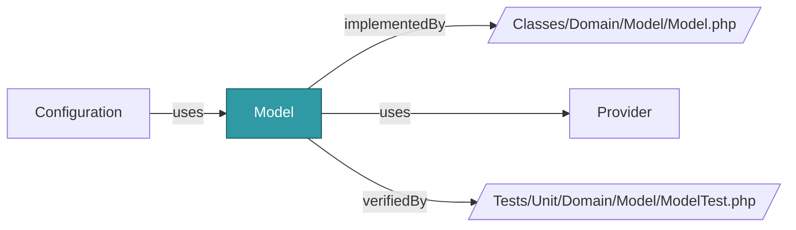

# Definition

A model is one LLM model that one provider offers. It holds the model ID at the vendor, its capabilities (for example chat, embeddings, vision, tools, decision), its context length and its prices. A model is the second tier of the three-tier configuration. Several configurations can use the same model.

# Not to be confused with

- The model ID string at the vendor (for example `gpt-5`). The model record holds that string in `model_id`, and adds capabilities and prices.

# Neighbours

Generated from the relation tables by `check-ontology.py --write-diagrams`. A solid arrow is an asserted relation, a dotted arrow a hypothesis; a slanted box is a file of the repository.

# Relations

| Relation | Target | Evidence file | Evidence text | Status |
|---|---|---|---|---|
| `uses` | [Provider](provider.md) | `Configuration/TCA/tx_nrllm_model.php` | `'foreign_table' => 'tx_nrllm_provider'` | asserted |
| `implementedBy` | `Classes/Domain/Model/Model.php` | `Classes/Domain/Model/Model.php` | `class Model extends AbstractEntity` | asserted |
| `verifiedBy` | `Tests/Unit/Domain/Model/ModelTest.php` | `Tests/Unit/Domain/Model/ModelTest.php` | `class ModelTest` | asserted |
