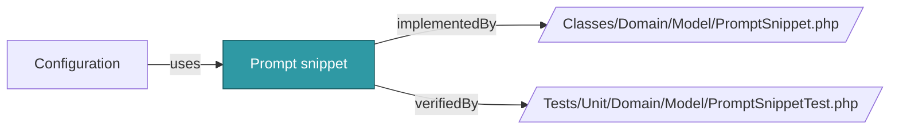

# Definition

A prompt snippet is a small named prompt fragment, for example a persona, a tone of voice or an image style. Editors manage snippets centrally. Consuming code selects snippets by tag, and a configuration can name tags whose snippets enter its prompts. ADR-031 records the decision.

# Not to be confused with

- A prompt template: a complete prompt with model parameters.

# Neighbours

Generated from the relation tables by `check-ontology.py --write-diagrams`. A solid arrow is an asserted relation, a dotted arrow a hypothesis; a slanted box is a file of the repository.

# Relations

| Relation | Target | Evidence file | Evidence text | Status |
|---|---|---|---|---|
| `implementedBy` | `Classes/Domain/Model/PromptSnippet.php` | `Classes/Domain/Model/PromptSnippet.php` | `Deliberately NOT a PromptTemplate` | asserted |
| `verifiedBy` | `Tests/Unit/Domain/Model/PromptSnippetTest.php` | `Tests/Unit/Domain/Model/PromptSnippetTest.php` | `class PromptSnippetTest` | asserted |
