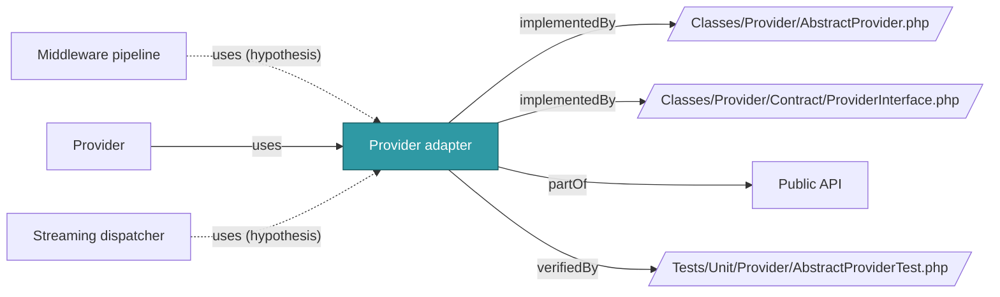

# Definition

A provider adapter is the PHP class that sends requests to one vendor API and returns typed responses. Every adapter implements the common provider contract and optional capability interfaces (streaming, tools, vision, documents). The adapter type of a provider selects the adapter.

# Not to be confused with

- A provider record. The adapter is code; the provider is configuration in the database.

# Neighbours

Generated from the relation tables by `check-ontology.py --write-diagrams`. A solid arrow is an asserted relation, a dotted arrow a hypothesis; a slanted box is a file of the repository.

# Relations

| Relation | Target | Evidence file | Evidence text | Status |
|---|---|---|---|---|
| `implementedBy` | `Classes/Provider/AbstractProvider.php` | `Classes/Provider/AbstractProvider.php` | `abstract class AbstractProvider implements ProviderInterface` | asserted |
| `implementedBy` | `Classes/Provider/Contract/ProviderInterface.php` | `Classes/Provider/Contract/ProviderInterface.php` | `interface ProviderInterface` | asserted |
| `verifiedBy` | `Tests/Unit/Provider/AbstractProviderTest.php` | `Tests/Unit/Provider/AbstractProviderTest.php` | `class AbstractProviderTest` | asserted |
| `partOf` | [Public API](public-api.md) | `Tests/Unit/Api/api-surface.txt` | `Netresearch\NrLlm\Provider\Contract\ProviderInterface (interface)` | asserted |

# Notes

- `Classes/Provider/` holds one adapter class per vendor API, for example OpenAI, Azure OpenAI, Claude, Gemini, Groq, Mistral, Ollama and OpenRouter, and the decision adapters (`TypeSafeProvider`, `DecisionSidecarProvider`). `ProviderAdapterRegistry` holds the full list at runtime.
