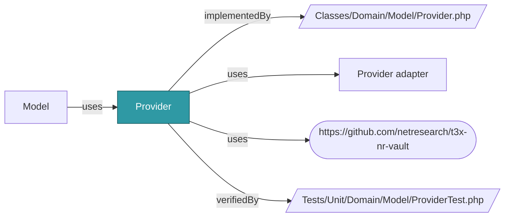

# Definition

A provider is a configured connection to the API of one LLM vendor. It holds the endpoint, the reference to the API key and the adapter type. Several providers can share one adapter type, for example `openai-prod` and `openai-dev`. A provider is the first tier of the three-tier configuration (provider, model, configuration).

# Not to be confused with

- The vendor company (OpenAI, Anthropic). One vendor can have several providers.
- The provider adapter: the PHP class that speaks the vendor API. A provider selects an adapter through its adapter type.

# Neighbours

Generated from the relation tables by `check-ontology.py --write-diagrams`. A solid arrow is an asserted relation, a dotted arrow a hypothesis; a slanted box is a file of the repository.

# Relations

| Relation | Target | Evidence file | Evidence text | Status |
|---|---|---|---|---|
| `uses` | [Provider adapter](provider-adapter.md) | `Configuration/TCA/tx_nrllm_provider.php` | `'adapter_type' =>` | asserted |
| `uses` | [nr-vault secret](https://github.com/netresearch/t3x-nr-vault) | `Classes/Domain/Model/Provider.php` | `$result = $vault->retrieve($this->apiKey) ?? '';` | asserted |
| `implementedBy` | `Classes/Domain/Model/Provider.php` | `Classes/Domain/Model/Provider.php` | `class Provider extends AbstractEntity` | asserted |
| `verifiedBy` | `Tests/Unit/Domain/Model/ProviderTest.php` | `Tests/Unit/Domain/Model/ProviderTest.php` | `class ProviderTest` | asserted |

# Notes

- The API key is stored in nr-vault (the extension `netresearch/nr-vault`). The provider holds only the vault identifier.
- Besides the setup wizard, the console command `nrllm:provider:set-key` stores a key for a provider from an unattended context; it reads the key from standard input (`Classes/Command/SetProviderApiKeyCommand.php`).
