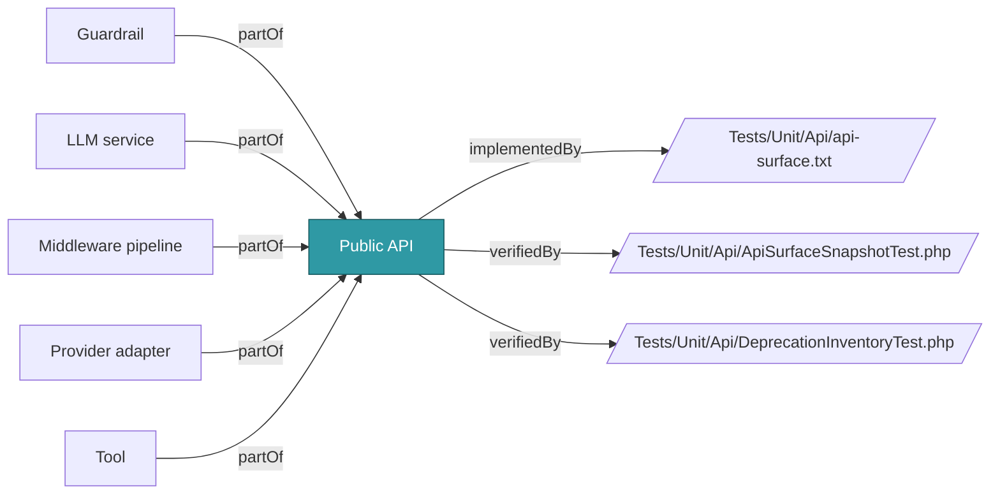

# Definition

The public API is the set of classes and methods marked `@api`: the feature services, the LLM service manager, the option classes, the response and value objects, and the typed exceptions. Within a major version no `@api` class or method is removed and no signature changes incompatibly. While nr_llm is below 1.0, that promise applies one level down: a minor release (0.N to 0.N+1) may break, and only with a CHANGELOG entry under a BREAKING heading; a patch release does not break. A snapshot file freezes every `@api` signature, and a test fails when a signature changes without an update of the snapshot. Besides the interfaces consuming code calls, it holds the extension points third parties implement, marked `@api Extension point`; `Documentation/Api/Stability.rst` lists them. The bundle models four of them: the tool, guardrail, provider and middleware interfaces.

# Neighbours

Generated from the relation tables by `check-ontology.py --write-diagrams`. A solid arrow is an asserted relation, a dotted arrow a hypothesis; a slanted box is a file of the repository.

# Relations

| Relation | Target | Evidence file | Evidence text | Status |
|---|---|---|---|---|
| `implementedBy` | `Tests/Unit/Api/api-surface.txt` | `Tests/Unit/Api/ApiSurfaceSnapshotTest.php` | `private const SNAPSHOT_PATH = __DIR__ . '/api-surface.txt';` | asserted |
| `verifiedBy` | `Tests/Unit/Api/ApiSurfaceSnapshotTest.php` | `Tests/Unit/Api/ApiSurfaceSnapshotTest.php` | `class ApiSurfaceSnapshotTest` | asserted |
| `verifiedBy` | `Tests/Unit/Api/DeprecationInventoryTest.php` | `Tests/Unit/Api/DeprecationInventoryTest.php` | `class DeprecationInventoryTest` | asserted |
