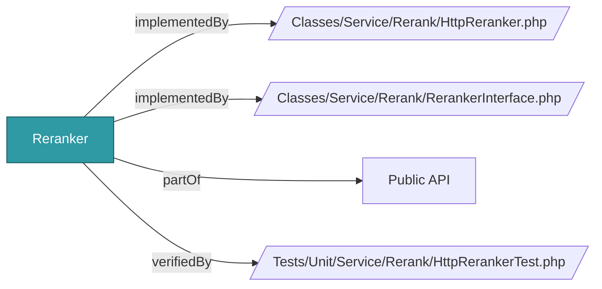

# Definition

A reranker scores candidates against a query. Candidates go in as plain id and text pairs, and scores come back as id and score pairs. The consumer orders the candidates, decides what to do when the reranker fails, and applies any score threshold. nr-llm ships an implementation that calls an HTTP endpoint, and a null implementation.

# Not to be confused with

- Keyword search, which finds the candidates.

# Neighbours

Generated from the relation tables by `check-ontology.py --write-diagrams`. A solid arrow is an asserted relation, a dotted arrow a hypothesis; a slanted box is a file of the repository.

# Relations

| Relation | Target | Evidence file | Evidence text | Status |
|---|---|---|---|---|
| `partOf` | [Public API](public-api.md) | `Tests/Unit/Api/api-surface.txt` | `Netresearch\NrLlm\Service\Rerank\RerankerInterface (interface)` | asserted |
| `implementedBy` | `Classes/Service/Rerank/RerankerInterface.php` | `Classes/Service/Rerank/RerankerInterface.php` | `interface RerankerInterface` | asserted |
| `implementedBy` | `Classes/Service/Rerank/HttpReranker.php` | `Classes/Service/Rerank/HttpReranker.php` | `final readonly class HttpReranker implements RerankerInterface` | asserted |
| `verifiedBy` | `Tests/Unit/Service/Rerank/HttpRerankerTest.php` | `Tests/Unit/Service/Rerank/HttpRerankerTest.php` | `class HttpRerankerTest` | asserted |
