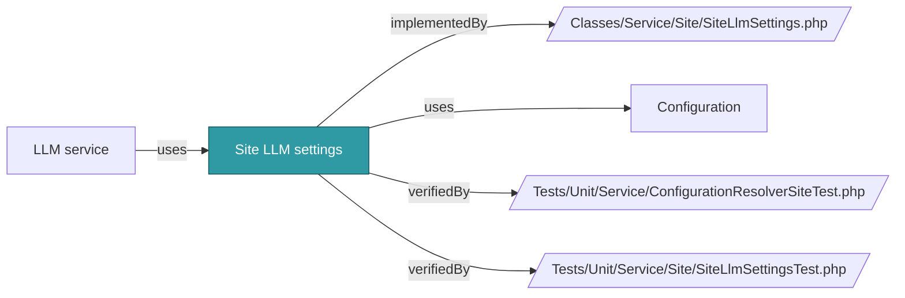

# Definition

Site LLM settings are two settings of a TYPO3 site: `nrllm.configuration`, the identifier of the configuration the calls of that site use, and `nrllm.deepl.apiKeyIdentifier`, the nr-vault identifier of the DeepL key its translations use. A setting holds an identifier, never a key. An empty setting or an unknown site means that the site names nothing.

# Not to be confused with

- The default configuration of the installation (`is_default` on `tx_nrllm_configuration`). A site setting replaces it for the calls of that site.

# Neighbours

Generated from the relation tables by `check-ontology.py --write-diagrams`. A solid arrow is an asserted relation, a dotted arrow a hypothesis; a slanted box is a file of the repository.

# Relations

| Relation | Target | Evidence file | Evidence text | Status |
|---|---|---|---|---|
| `uses` | [Configuration](configuration.md) | `Classes/Service/Site/SiteLlmSettings.php` | `public const CONFIGURATION = 'nrllm.configuration';` | asserted |
| `implementedBy` | `Classes/Service/Site/SiteLlmSettings.php` | `Classes/Service/Site/SiteLlmSettings.php` | `final readonly class SiteLlmSettings` | asserted |
| `verifiedBy` | `Tests/Unit/Service/Site/SiteLlmSettingsTest.php` | `Tests/Unit/Service/Site/SiteLlmSettingsTest.php` | `class SiteLlmSettingsTest` | asserted |
| `verifiedBy` | `Tests/Unit/Service/ConfigurationResolverSiteTest.php` | `Tests/Unit/Service/ConfigurationResolverSiteTest.php` | `class ConfigurationResolverSiteTest` | asserted |

# Notes

- A call without a configuration and without a pinned provider gets the configuration its site names. Only when the site names none does it get the installation default. A site that names a configuration that does not exist, is inactive or may not be used makes the call fail; it does not fall back to the default (`Classes/Service/ConfigurationResolver.php`, ADR-244).
