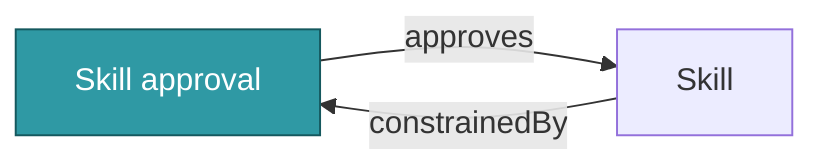

# Definition

A skill approval records that a person approved one version of one skill, identified by its digest and its source. A revocation marks every approval of that skill and digest.

# Neighbours

Generated from the relation tables by `check-ontology.py --write-diagrams`. A solid arrow is an asserted relation, a dotted arrow a hypothesis; a slanted box is a file of the repository.

# Relations

| Relation | Target | Evidence file | Evidence text | Status |
|---|---|---|---|---|
| `approves` | [Skill](skill.md) | `ext_tables.sql` | `KEY skill_source_digest (skill_uid, source_uid, version_digest)` | asserted |
