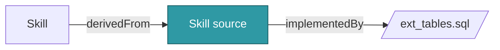

# Definition

A skill source is a place from which nr-llm takes skills. Three types import from GitHub: one `SKILL.md` file, a repository, or a marketplace index that lists several skills. The fourth type, `backend`, holds skills that an administrator writes in the TYPO3 backend; nothing is fetched for it, and the version digest comes from the current fields (ADR-214).

# Neighbours

Generated from the relation tables by `check-ontology.py --write-diagrams`. A solid arrow is an asserted relation, a dotted arrow a hypothesis; a slanted box is a file of the repository.

# Relations

| Relation | Target | Evidence file | Evidence text | Status |
|---|---|---|---|---|
| `implementedBy` | `ext_tables.sql` | `ext_tables.sql` | `GitHub-hosted skill sources (single SKILL.md, repo, or marketplace index)` | asserted |
