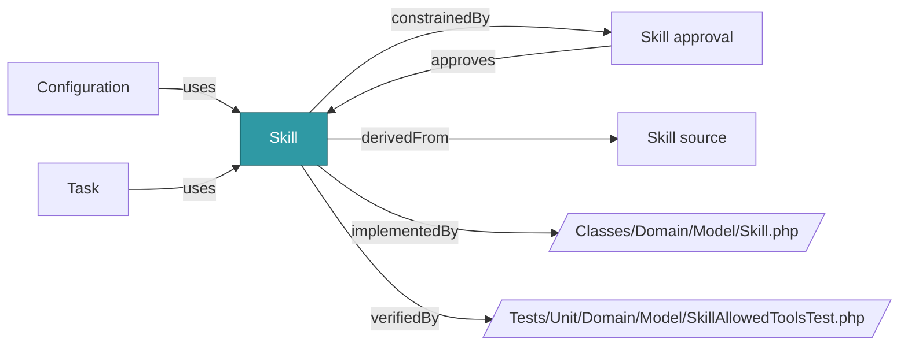

# Definition

A skill is a set of instructions for a model, parsed from one `SKILL.md` file of a skill source, or written in the backend for a source of the type `backend`. Each skill version has a digest. A configuration or a task attaches skills, and the skills then enter the prompt. A skill carries the trust level of its source and a sensitivity ceiling that an operator declares.

# Not to be confused with

- The skill ID of an A2A profile (`skill_id`): that names a capability an agent offers to remote agents.
- A tool.

# Neighbours

Generated from the relation tables by `check-ontology.py --write-diagrams`. A solid arrow is an asserted relation, a dotted arrow a hypothesis; a slanted box is a file of the repository.

# Relations

| Relation | Target | Evidence file | Evidence text | Status |
|---|---|---|---|---|
| `derivedFrom` | [Skill source](skill-source.md) | `ext_tables.sql` | `Parsed SKILL.md records materialized from a skill source` | asserted |
| `constrainedBy` | [Skill approval](skill-approval.md) | `Classes/Service/Skill/SkillInstructionPolicy.php` | `an unrevoked approval names the skill, its current source and the digest` | asserted |
| `implementedBy` | `Classes/Domain/Model/Skill.php` | `Classes/Domain/Model/Skill.php` | `class Skill` | asserted |
| `verifiedBy` | `Tests/Unit/Domain/Model/SkillAllowedToolsTest.php` | `Tests/Unit/Domain/Model/SkillAllowedToolsTest.php` | `class SkillAllowedToolsTest` | asserted |

# Notes

- A skill version enters a prompt as an instruction only if the trust level of its source reaches the configured threshold and an unrevoked approval names that skill, its current source and its digest (`Classes/Service/Skill/SkillInstructionPolicy.php`, ADR-214).
