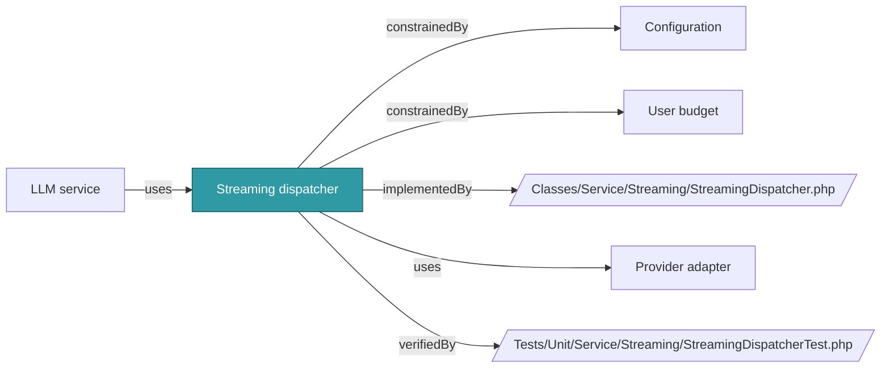

# Definition

The streaming dispatcher carries a streamed call. A streamed provider call cannot pass the middleware pipeline, because a PHP generator is lazy: wrapped as the pipeline terminal, every step would run before the stream starts. The dispatcher therefore runs the budget check before the stream and records usage and telemetry around it, as a wrapping generator (ADR-062). Without a dispatcher, the LLM service manager calls the provider directly.

# Neighbours

Generated from the relation tables by `check-ontology.py --write-diagrams`. A solid arrow is an asserted relation, a dotted arrow a hypothesis; a slanted box is a file of the repository.

# Relations

| Relation | Target | Evidence file | Evidence text | Status |
|---|---|---|---|---|
| `uses` | [Provider adapter](provider-adapter.md) | `Classes/Service/LlmServiceManager.php` | `return $adapter->streamChatCompletion(` | asserted |
| `constrainedBy` | [User budget](user-budget.md) | `Classes/Service/Streaming/StreamingDispatcher.php` | `private BudgetServiceInterface $budgetService,` | asserted |
| `constrainedBy` | [Configuration](configuration.md) | `Classes/Service/Streaming/StreamingDispatcher.php` | `$this->assertWithinBudget($context, $configuration);` | asserted |
| `implementedBy` | `Classes/Service/Streaming/StreamingDispatcher.php` | `Classes/Service/Streaming/StreamingDispatcher.php` | `final readonly class StreamingDispatcher` | asserted |
| `verifiedBy` | `Tests/Unit/Service/Streaming/StreamingDispatcherTest.php` | `Tests/Unit/Service/Streaming/StreamingDispatcherTest.php` | `class StreamingDispatcherTest` | asserted |

# Notes

- The dispatcher checks the budget against the user budget and the daily limits of the configuration, and it runs the fallback chain of the configuration. Which other middleware steps apply to a stream is not modelled.
- The dispatcher takes an opener callable that starts the stream. The `uses` row to Provider adapter cites the opener the LLM service manager passes in, which calls `streamChatCompletion()` on the adapter.
