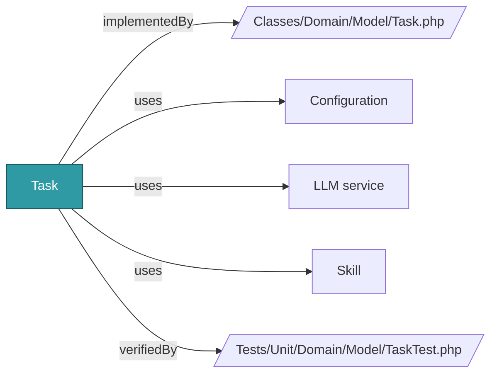

# Definition

A task is a predefined one-shot prompt template for a common job, for example to analyze a log or to write a text. A task runs on one configuration. The class comment states that a task is no agent: it does no multi-step reasoning and keeps no conversation.

# Not to be confused with

- An A2A task: a unit of work that a remote agent sends over the Agent2Agent protocol. That is a different table (`tx_nrllm_a2a_task`) and is not modelled here.
- An agent run.
- A scheduler task of TYPO3.

# Neighbours

Generated from the relation tables by `check-ontology.py --write-diagrams`. A solid arrow is an asserted relation, a dotted arrow a hypothesis; a slanted box is a file of the repository.

# Relations

| Relation | Target | Evidence file | Evidence text | Status |
|---|---|---|---|---|
| `uses` | [Configuration](configuration.md) | `Configuration/TCA/tx_nrllm_task.php` | `'foreign_table' => 'tx_nrllm_configuration'` | asserted |
| `uses` | [Skill](skill.md) | `ext_tables.sql` | `CREATE TABLE tx_nrllm_task_skill_mm` | asserted |
| `uses` | [LLM service](llm-service.md) | `Classes/Service/Task/TaskExecutionService.php` | `private LlmServiceManagerInterface $llmServiceManager` | asserted |
| `implementedBy` | `Classes/Domain/Model/Task.php` | `Classes/Domain/Model/Task.php` | `They are NOT AI agents` | asserted |
| `verifiedBy` | `Tests/Unit/Domain/Model/TaskTest.php` | `Tests/Unit/Domain/Model/TaskTest.php` | `class TaskTest` | asserted |
