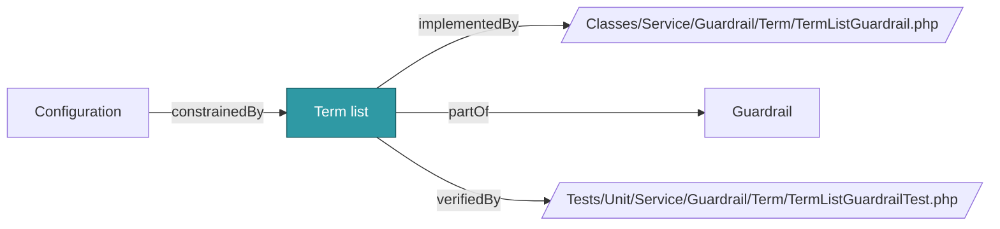

# Definition

A term list names terms that must not appear, or must appear, in an output. The term list guardrail checks the output of every configuration the list names. A list can be limited to one site and one language; an empty site or language means every site or every language, and required terms apply only to text outputs of a call whose site and language match. A call without site or language is still checked against the forbidden terms of a limited list. In a run that offers tools, the guardrail checks only the arguments of writing-tool calls, and only for forbidden terms. A violation blocks the output with the reason. ADR-238 records the decision.

# Not to be confused with

- A glossary. A glossary maps a term of one language to a term of another language for translation.

# Neighbours

Generated from the relation tables by `check-ontology.py --write-diagrams`. A solid arrow is an asserted relation, a dotted arrow a hypothesis; a slanted box is a file of the repository.

# Relations

| Relation | Target | Evidence file | Evidence text | Status |
|---|---|---|---|---|
| `partOf` | [Guardrail](guardrail.md) | `Classes/Service/Guardrail/Term/TermListGuardrail.php` | `final readonly class TermListGuardrail implements ContextualGuardrailInterface` | asserted |
| `implementedBy` | `Classes/Service/Guardrail/Term/TermListGuardrail.php` | `Classes/Service/Guardrail/Term/TermListGuardrail.php` | `final readonly class TermListGuardrail` | asserted |
| `verifiedBy` | `Tests/Unit/Service/Guardrail/Term/TermListGuardrailTest.php` | `Tests/Unit/Service/Guardrail/Term/TermListGuardrailTest.php` | `final class TermListGuardrailTest extends AbstractUnitTestCase` | asserted |
