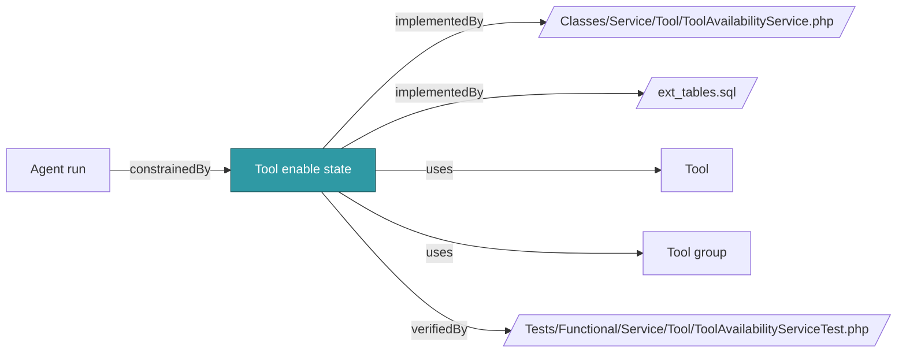

# Definition

The tool enable state decides which registered tools may run at all, in every configuration and every agent run. A tool is enabled when its own state is enabled and its group is enabled. The state of a tool is the override an administrator set in the tool module (table `tx_nrllm_tool_state`), else the default the tool declares. The state of a group is its override (table `tx_nrllm_tool_group_state`), else enabled. An override on a tool cannot enable it inside a disabled group.

# Not to be confused with

- A tool group that a configuration allows: that limits the tools of runs under one configuration. The enable state applies to all of them.
- Excluded tools of a configuration.

# Neighbours

Generated from the relation tables by `check-ontology.py --write-diagrams`. A solid arrow is an asserted relation, a dotted arrow a hypothesis; a slanted box is a file of the repository.

# Relations

| Relation | Target | Evidence file | Evidence text | Status |
|---|---|---|---|---|
| `uses` | [Tool](tool.md) | `Classes/Service/Tool/ToolAvailabilityService.php` | `private ToolRegistry $registry,` | asserted |
| `uses` | [Tool group](tool-group.md) | `Classes/Service/Tool/ToolAvailabilityService.php` | `$groupEnabled = $groupOverrides[$group] ?? true;` | asserted |
| `implementedBy` | `Classes/Service/Tool/ToolAvailabilityService.php` | `Classes/Service/Tool/ToolAvailabilityService.php` | `final readonly class ToolAvailabilityService implements ToolAvailabilityServiceInterface` | asserted |
| `implementedBy` | `ext_tables.sql` | `ext_tables.sql` | `CREATE TABLE tx_nrllm_tool_state (` | asserted |
| `implementedBy` | `ext_tables.sql` | `ext_tables.sql` | `CREATE TABLE tx_nrllm_tool_group_state (` | asserted |
| `verifiedBy` | `Tests/Functional/Service/Tool/ToolAvailabilityServiceTest.php` | `Tests/Functional/Service/Tool/ToolAvailabilityServiceTest.php` | `class ToolAvailabilityServiceTest` | asserted |

# Notes

- The tool call policy asks the enable state first on every decision, before the admin-only check, the skill allow-list, the excluded tools and the trust zone (`Classes/Service/Tool/ToolCallPolicy.php`).
