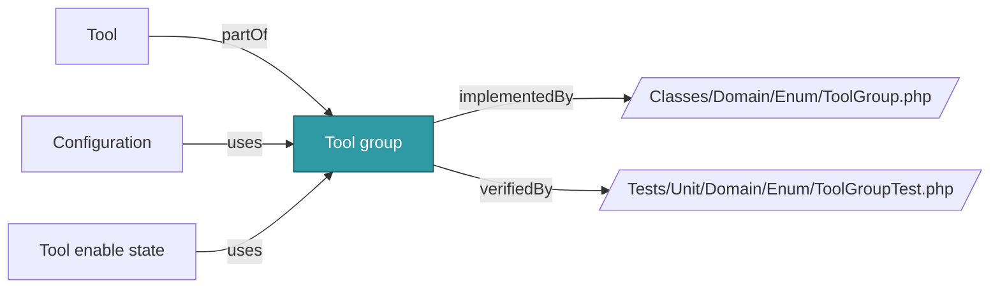

# Definition

A tool group is a named group of tools, for example `content`, `editing` or `system`. A configuration allows tools by group. The set of groups is open: an extension that ships a tool can declare its own group. nr-llm ships a fixed list of its own groups.

# Neighbours

Generated from the relation tables by `check-ontology.py --write-diagrams`. A solid arrow is an asserted relation, a dotted arrow a hypothesis; a slanted box is a file of the repository.

# Relations

| Relation | Target | Evidence file | Evidence text | Status |
|---|---|---|---|---|
| `implementedBy` | `Classes/Domain/Enum/ToolGroup.php` | `Classes/Domain/Enum/ToolGroup.php` | `A group is an OPEN set` | asserted |
| `verifiedBy` | `Tests/Unit/Domain/Enum/ToolGroupTest.php` | `Tests/Unit/Domain/Enum/ToolGroupTest.php` | `final class ToolGroupTest extends TestCase` | asserted |
