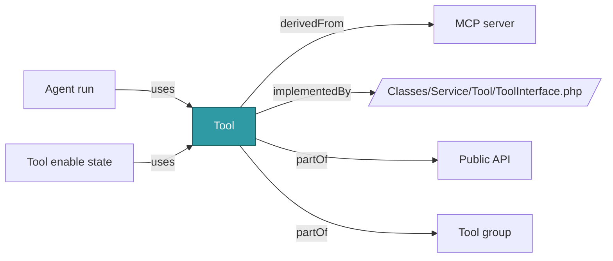

# Definition

A tool is an action that a model can call during an agent run, for example read a page tree or create a content element draft. A tool is either built in (shipped with nr-llm or another extension) or imported from an MCP server. Every tool names its group.

# Not to be confused with

- A skill. A skill is instructions in text; a tool is an action with an effect.

# Neighbours

Generated from the relation tables by `check-ontology.py --write-diagrams`. A solid arrow is an asserted relation, a dotted arrow a hypothesis; a slanted box is a file of the repository.

# Relations

| Relation | Target | Evidence file | Evidence text | Status |
|---|---|---|---|---|
| `partOf` | [Tool group](tool-group.md) | `Classes/Service/Tool/ToolInterface.php` | `public function getGroup(): string;` | asserted |
| `derivedFrom` | [MCP server](mcp-server.md) | `ext_tables.sql` | `server int(11) unsigned DEFAULT '0' NOT NULL` | asserted |
| `implementedBy` | `Classes/Service/Tool/ToolInterface.php` | `Classes/Service/Tool/ToolInterface.php` | `interface ToolInterface` | asserted |
| `partOf` | [Public API](public-api.md) | `Classes/Service/Tool/ToolInterface.php` | `@api Extension point` | asserted |

# Notes

- The `derivedFrom` row holds for imported MCP tools only (table `tx_nrllm_mcp_tool`). Built-in tools are in `Classes/Service/Tool/Builtin/`.
