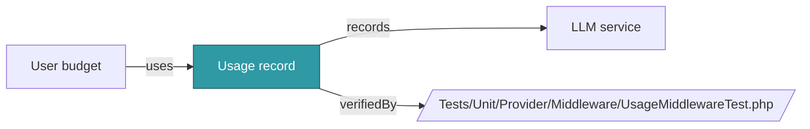

# Definition

A usage record holds the counted usage of one kind of service on one day: requests, tokens, characters, audio seconds, images and the estimated cost. It names the configuration, the model, the task, the backend user and the calling extension.

# Neighbours

Generated from the relation tables by `check-ontology.py --write-diagrams`. A solid arrow is an asserted relation, a dotted arrow a hypothesis; a slanted box is a file of the repository.

# Relations

| Relation | Target | Evidence file | Evidence text | Status |
|---|---|---|---|---|
| `records` | [LLM service](llm-service.md) | `Classes/Provider/Middleware/UsageMiddleware.php` | `Records usage to tx_nrllm_service_usage after a successful provider call.` | asserted |
| `verifiedBy` | `Tests/Unit/Provider/Middleware/UsageMiddlewareTest.php` | `Tests/Unit/Provider/Middleware/UsageMiddlewareTest.php` | `class UsageMiddlewareTest` | asserted |
