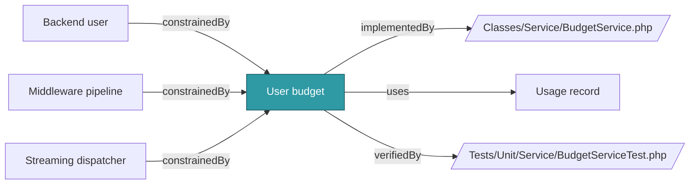

# Definition

A user budget sets daily and monthly ceilings for the requests, the tokens and the cost of one backend user. A request must stay under both windows. The value `0` means no limit on that axis. The budget is a ceiling, not a counter: the usage is summed from the usage records. The check runs before the call. Requests and cost include the planned call; tokens count only the recorded usage, so a call can take the token total past the ceiling, and concurrent calls can pass before their usage is recorded.

# Neighbours

Generated from the relation tables by `check-ontology.py --write-diagrams`. A solid arrow is an asserted relation, a dotted arrow a hypothesis; a slanted box is a file of the repository.

# Relations

| Relation | Target | Evidence file | Evidence text | Status |
|---|---|---|---|---|
| `uses` | [Usage record](usage-record.md) | `Classes/Domain/Model/UserBudget.php` | `demand from tx_nrllm_service_usage` | asserted |
| `implementedBy` | `Classes/Service/BudgetService.php` | `Classes/Service/BudgetService.php` | `private UserBudgetRepository $repository` | asserted |
| `verifiedBy` | `Tests/Unit/Service/BudgetServiceTest.php` | `Tests/Unit/Service/BudgetServiceTest.php` | `class BudgetServiceTest` | asserted |
